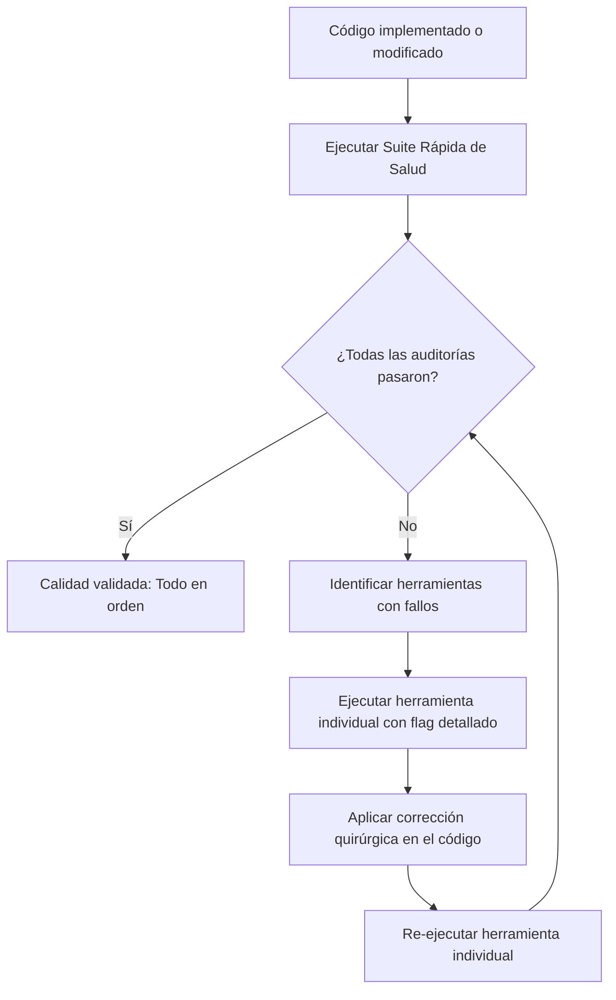

# MiniKick Quality Auditor

Esta skill define el procedimiento estándar para verificar la calidad del código, el cumplimiento de las reglas arquitectónicas y la detección/corrección de violaciones tras cualquier cambio o refactor en MiniKick.

## 1. Visión General del Flujo



---

## 2. Paso 1: Ejecución de la Suite de Salud (Diagnóstico Global)

Ejecutar la suite maestra de salud en modo rápido y detallado desde la raíz del proyecto:

```powershell
python resources/tools/project_quality_suite.py --quick --verbose
```

La suite evalúa:
* **Project Icon Integrity** (`project_icon_integrity_tool.py`)
* **Project Translation Integrity** (`project_translation_integrity_auditor.py`)
* **Frontend Hardcoded Text** (`frontend_hardcoded_text_auditor.py`)
* **Project Dead Code** (`project_dead_code_auditor.py`)
* **Frontend QSS Roles & States** (`frontend_qss_role_state_auditor.py`)
* **Project Unused Parameters** (`project_unused_parameter_auditor.py`)
* **Frontend Qt Signal Lifecycle** (`frontend_qt_signal_lifecycle_auditor.py`)
* **Frontend Design Tokens** (`frontend_design_token_auditor.py`)
* **Project Code Duplication** (`project_code_duplication_auditor.py`)
* **Project Architecture Boundaries** (`project_architecture_boundary_auditor.py`)
* **Project File Placement** (`project_file_placement_auditor.py`)
* **Frontend Qt Window Lifecycle** (`frontend_qt_window_lifecycle_auditor.py`)

---

## 3. Paso 2: Diagnóstico y Corrección de Fallos Específicos

Si alguna herramienta reporta `❌ FAIL`, ejecuta la herramienta específica directamente para obtener el reporte granular con líneas y archivos exactos:

### A. Fallos en i18n o Textos Hardcodeados (`frontend_hardcoded_text_auditor.py` / `project_translation_integrity_auditor.py`)
* **Comando:**
  ```powershell
  python resources/tools/frontend_hardcoded_text_auditor.py
  python resources/tools/project_translation_integrity_auditor.py --check
  ```
* **Protocolo de Corrección:**
  - **PROHIBIDO:** Usar cadenas de texto literales en widgets (`setText("Hola")`, `QLabel("Guardar")`).
  - **PROHIBIDO:** Usar fallbacks inline (`self.i18n.get("key") or "Fallback"`).
  - **SOLUCIÓN:** Agregar la clave correspondiente en `locales/es.json` y `locales/en.json` manteniendo paridad exacta. Usar `self.i18n.get("clave")` o `self.i18n.t("clave")`.

### B. Fallos en Fronteras de Arquitectura (`project_architecture_boundary_auditor.py`)
* **Comando:**
  ```powershell
  python resources/tools/project_architecture_boundary_auditor.py
  ```
* **Protocolo de Corrección:**
  - **Separación de Responsabilidades (SoR):** UI no debe hacer consultas a base de datos ni llamadas HTTP directas.
  - La capa de presentación (`frontend/`) debe interactuar únicamente a través de controladores o servicios (`backend/services/`, `controllers/`).
  - Desacoplar importaciones cruzadas prohibidas mediante inyección de dependencias o señales Qt.

### C. Parámetros No Usados o Código Muerto (`project_unused_parameter_auditor.py` / `project_dead_code_auditor.py`)
* **Comando:**
  ```powershell
  python resources/tools/project_unused_parameter_auditor.py
  python resources/tools/project_dead_code_auditor.py
  ```
* **Protocolo de Corrección:**
  - Prefijar con `_` los parámetros obligatorios por firma de interfaz/señal Qt pero no referenciados (ej. `_event`, `_index`).
  - Eliminar parámetros redundantes creados durante el cambio.

### D. Duplicación de Código (`project_code_duplication_auditor.py`)
* **Comando:**
  ```powershell
  python resources/tools/project_code_duplication_auditor.py --min-statements 8 --strict
  ```
* **Protocolo de Corrección:**
  - Extraer lógica repetida a métodos auxiliares privados o utilidades compartidas si se repite en 3 o más lugares (Regla del 3).
  - Mantener la legibilidad y simplicidad (KISS).

### E. Ubicación y Nomenclatura (`project_file_placement_auditor.py`)
* **Comando:**
  ```powershell
  python resources/tools/project_file_placement_auditor.py
  ```
* **Protocolo de Corrección:**
  - Asegurar que widgets nuevos estén en `frontend/widgets/` o `frontend/components/`.
  - Asegurar que controladores estén en sus directorios canónicos correspondientes.

### F. Fugas de Ventanas / HWND (`frontend_qt_window_lifecycle_auditor.py`)
* **Comando:**
  ```powershell
  python resources/tools/frontend_qt_window_lifecycle_auditor.py --static-only
  ```
* **Protocolo de Corrección:**
  - Asegurar parentesco explícito en diálogos o widgets flotantes (`QDialog(parent)`).
  - Configurar `setAttribute(Qt.WidgetAttribute.WA_DeleteOnClose, True)` donde corresponda para evitar ventanas fantasma en Windows.

---

## 4. Paso 3: Re-validación Final

Una vez corregidas las anomalías:
1. Re-ejecutar la herramienta individual para confirmar `✅ PASS`.
2. Volver a correr la suite de salud global:
   ```powershell
   python resources/tools/project_quality_suite.py --quick
   ```
3. Confirmar que no hubo regresiones antes de entregar el resultado al usuario.
