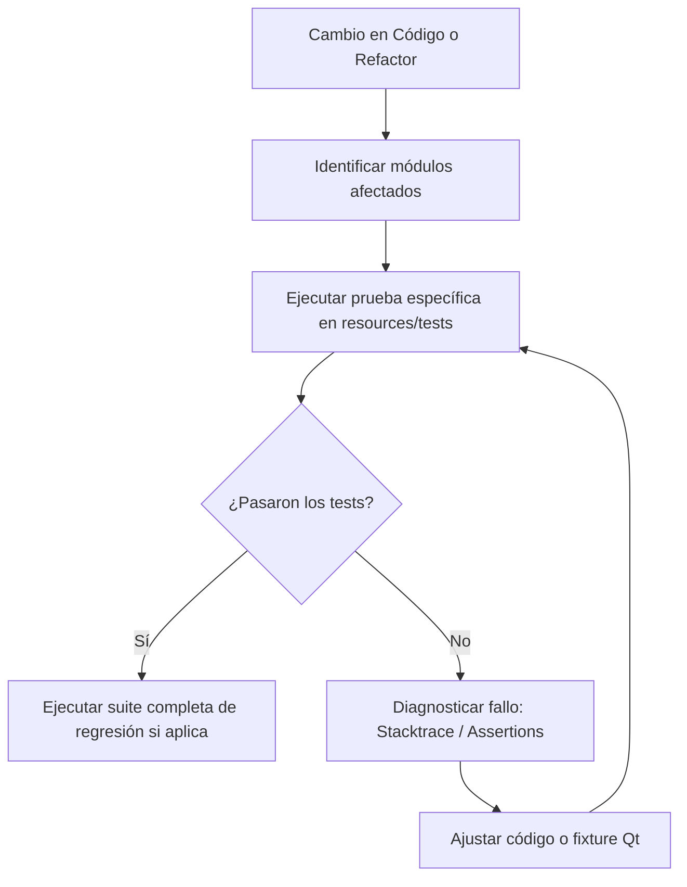

# MiniKick Test Runner

Esta skill define el procedimiento para ejecutar, aislar y diagnosticar la suite de pruebas unitarias y de integración en `resources/tests/`.

## 1. Visión General del Flujo



---

## 2. Comandos de Ejecución

### A. Ejecución de un Test Específico
Al modificar un módulo concreto, no ejecutes toda la suite; enfócate en el test correspondiente:

```powershell
pytest resources/tests/test_architecture_and_placement_auditors.py -v
pytest resources/tests/test_quality_auditors.py -v
pytest resources/tests/test_commands_sanitization.py -v
```

### B. Filtrado por Función o Clase
Para ejecutar una sola prueba dentro de un archivo:

```powershell
pytest resources/tests/test_quality_auditors.py -k "test_anti_hardcode" -v
```

### C. Ejecución de Suite Completa
Para verificación global de regresiones:

```powershell
pytest resources/tests/ --tb=short
```

---

## 3. Consideraciones Especiales para Pruebas en MiniKick

### A. Componentes de UI y PySide6 (`qapp` Fixture)
* Todos los widgets Qt requieren que exista una instancia de `QApplication`.
* Asegúrate de que las pruebas que instancian widgets utilicen la fixture `qapp` provista en `resources/tests/conftest.py`:
  ```python
  def test_custom_widget(qapp):
      widget = MyCustomWidget()
      assert widget is not None
  ```

### B. Concurrencia y Workers (`QThread`)
* En tests que involucren workers asíncronos (`KickChatWorker`, `MusicWorker`), evita `time.sleep()` bloqueantes.
* Utiliza espías de señales Qt (`QSignalSpy` o callbacks con timeouts explícitos) para evitar que las pruebas se congelen o causen fugas de memoria (`Destroyed while thread is still running`).

### C. Base de Datos en Memoria / Aislada
* Al probar servicios que interactúen con SQLite, verifica que utilicen bases de datos temporales o mocks de conexión, nunca la base de datos de producción local.
