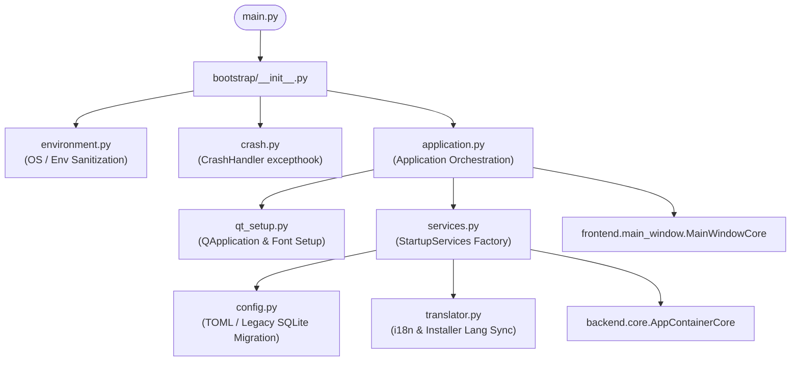

# Package Contract: `bootstrap`

## 1. Overview & System Scope

The `bootstrap` package governs the startup lifecycle, execution prerequisites, crash interception, and dependency wiring for **MiniKick**. It acts as the outermost architectural perimeter between the operating system environment (process state, Windows shell, environment variables, sockets) and the inner presentation/domain subsystems (`frontend` and `backend`).

Key architectural responsibilities:
- **Environment Sanitization & Bootstrapping**: Cleans system `PATH`, suppresses noisy external C-extensions/Qt logging, loads environment configuration, and sets process-level Windows taskbar identifiers.
- **Fail-Safe Crash Interception**: Global `sys.excepthook` implementation providing persistent fault logging and interactive Discord crash reporting dialogs.
- **Application Lifecycle Orchestration**: Sequential staging of logging, splash screen progress tracking, single-instance socket mutual exclusion, DI container assembly, and main window restoration.
- **Lazy Module Resolution**: Dynamic `__getattr__` export loading in `__init__.py` ensuring zero overhead on initial import.

---

## 2. Component Topology



| Module | Role | Primary Export(s) |
| :--- | :--- | :--- |
| [`__init__.py`](./__init__.py) | Dynamic facade & deferred export resolver | `Application`, `CrashHandler`, `configure_environment` |
| [`environment.py`](./environment.py) | Process environment, path filtering & Windows App ID | `configure_environment()`, `set_windows_app_id()`, `PROCESS_STARTED` |
| [`crash.py`](./crash.py) | Unhandled exception handler & modal reporting | `CrashHandler` |
| [`application.py`](./application.py) | Main application lifecycle coordinator | `Application` |
| [`services.py`](./services.py) | Inversion of Control (IoC) factory for startup services | `StartupServices` |
| [`config.py`](./config.py) | Configuration provider resolver & SQLite->TOML migrator | `create_config_provider()` |
| [`qt_setup.py`](./qt_setup.py) | Qt application instance, fonts, palette, and styling | `create_application()`, `get_or_create_application()` |
| [`translator.py`](./translator.py) | Translator bootstrap & installer language synchronization | `load_translator()`, `FallbackTranslator` |

---

## 3. Public Interfaces & Contracts

### 3.1. `Application` ([`application.py`](./application.py))
Coordinates application initialization and the Qt GUI event loop.

```python
class Application:
    def __init__(
        self,
        services: StartupServices | None = None,
        logging_setup: Callable[[], tuple[Any, Any]] | None = None
    ) -> None: ...

    def run(self) -> int: ...
```
- **Preconditions**: Must be invoked from the main execution thread.
- **Postconditions**: Returns process exit code (`0` on clean exit, `1` on duplicate instance detected or fatal early abort). Releases instance socket lock upon exit.

### 3.2. `CrashHandler` ([`crash.py`](./crash.py))
Global uncaught exception sink attached to `sys.excepthook`.

```python
class CrashHandler:
    def __init__(
        self,
        app_provider: Callable[[], QApplication] = get_or_create_application,
        translator_provider: Callable[..., Any] = load_translator,
    ) -> None: ...

    def handle(self, exctype: type[BaseException], value: BaseException, tb: TracebackType) -> None: ...
```
- **Invariants**: Guarantees fault log persistence (`write_fault_log_record`) and logger buffer flushing before attempting UI dialog display. Terminate process with exit code 1.

### 3.3. `configure_environment` & `set_windows_app_id` ([`environment.py`](./environment.py))
Configures the execution environment prior to loading heavy libraries.

```python
def configure_environment() -> None: ...
def set_windows_app_id() -> None: ...
```

### 3.4. `StartupServices` ([`services.py`](./services.py))
Factory consolidating startup dependencies.

```python
class StartupServices:
    def create_database(self) -> DatabaseManager: ...
    def create_config(self, db_manager: DatabaseManager) -> IConfigProvider: ...
    def create_translator(self, db_manager: DatabaseManager) -> TranslationService | FallbackTranslator: ...
    def create_container(self, db_manager: DatabaseManager, i18n: Any) -> AppContainerCore: ...
    def create_instance_guard(self) -> SocketInstanceProvider: ...
    def create_updater(self) -> UpdateManager: ...
```

---

## 4. State & Lifecycle Invariants

1. **Lazy Dynamic Exports**: `bootstrap/__init__.py` uses `__getattr__` dispatch; importing `bootstrap` does not import Qt, SQLite, or backend modules until requested.
2. **Single Instance Mutual Exclusion**: `SocketInstanceProvider` binds to `localhost:45678`. If already held, startup aborts immediately and presents `AlreadyRunningDialog`.
3. **Idempotent Configuration Migration**: `_import_legacy_settings` in `config.py` converts SQLite `settings` records into `minikick.toml` once. On success, writes `settings_migrated_to_toml` marker. Subsequent launches bypass SQLite reads for configuration.
4. **Installer Language Handshake**: `translator.py` checks for `.install_lang` written by Inno Setup. If present, updates `app_language` config and unlinks the marker file.
5. **Fail-Safe Fallbacks**: If translation service initialization raises an exception, `load_translator()` falls back to `FallbackTranslator` (returning keys verbatim) rather than allowing a fatal crash.

---

## 5. System Boundaries & Side Effects

| Category | Boundary / Target | Description |
| :--- | :--- | :--- |
| **OS Environment** | `os.environ` | Sets `AV_LOG_LEVEL="fatal"`, `QT_LOGGING_RULES`, and removes invalid/non-existent paths from `PATH`. |
| **Windows Shell** | `ctypes.windll.shell32` | Sets explicit `AppUserModelID = "MiniKick"` on win32 platforms. |
| **Networking** | `localhost:45678` | Binds loopback TCP socket for instance concurrency detection. |
| **Teardown Hooks** | `asyncio.proactor_events` | Silences Proactor pipe transport teardown `__del__` warnings on Windows. |
| **Filesystem** | `%LOCALAPPDATA%\.Minikick\` | Accesses SQLite database, `minikick.toml`, and logs. Unlinks `.install_lang` in app directory. |
| **Process Control** | `sys.exit` | Terminates process on duplicate instance (`code=1`) or unhandled exception in `CrashHandler` (`code=1`). |

---

## 6. Algorithmic Complexity & Performance

- **Environment Sanitization**: $\mathcal{O}(k)$ where $k$ is the number of PATH entries (linear traversal with single `os.path.isdir` check per entry).
- **Export Resolution**: $\mathcal{O}(1)$ dictionary lookup in `_EXPORTS`.
- **Legacy Migration**: $\mathcal{O}(n)$ where $n$ is the number of legacy configuration keys, executed strictly on initial migration.
- **Font Registration**: $\mathcal{O}(m)$ where $m$ is the count of font files in `assets/fonts/`.

---

## 7. Verification & Testing

To verify the bootstrap components and dependencies across the suite:

```bash
# Execute full regression test suite
pytest resources/tests

# Run quality and dead-code verification on bootstrap modules
python resources/tools/project_quality_suite.py --all
```
