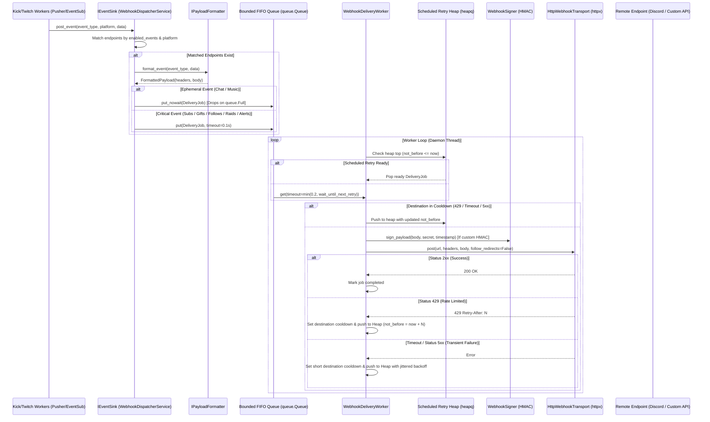

# Design Document: Outbound Webhook Delivery Service

* **Author:** Andro2k
* **Status:** Finalized
* **Created:** 2026-11-10
* **Target Version:** MiniKick v1.6.9

## 1. Problem Statement

Streamers on Kick and Twitch using MiniKick currently experience event isolation: stream events (subscriptions, gifted subs, follows, raids, viewer alerts, bot commands, and music playback) are processed strictly within local application windows and local browser overlay WebSockets. There is no supported mechanism to export these live events to external community channels or automation platforms.

Streamers who want to announce subscriptions in Discord, trigger smart room lighting (via Home Assistant or Node-RED), or forward stream analytics to self-hosted logging servers are currently forced to:
1. Run secondary standalone bots, duplicating API connections and authentication burdens.
2. Rely on custom JavaScript hooks injected into OBS browser sources to capture local WebSocket traffic and execute browser `fetch()` requests—a fragile workaround that fails whenever OBS is inactive, hidden, or crashed.
3. Manually type stream milestones or copy-paste bot commands during live broadcasts, creating cognitive distraction.

MiniKick requires a reliable, native outbound webhook dispatching capability that bridges live channel events to remote HTTP endpoints without compromising desktop client stability, audio playback, or UI fluidity.

## 2. Overview

The Outbound Webhook Delivery Service is an asynchronous, event-driven subsystem within MiniKick that listens to internal platform events and delivers formatted HTTP POST notifications to user-defined webhooks.

The subsystem operates as an external boundary adapter:
* It consumes events via a unified `IEventSink` interface, decoupled from individual domain services.
* It normalizes payloads using interchangeable formatting adapters (`GenericJsonFormatter` for standard web endpoints and `DiscordEmbedFormatter` for Discord channels).
* It executes deliveries through a dedicated, non-Qt background worker thread (`threading.Thread(daemon=True)`) using a single bounded queue with non-blocking admission for ephemeral traffic, a min-heap for scheduled retries (`not_before`), and per-destination cooldown on rate limits (HTTP 429), timeouts, and 5xx errors.
* It transports requests via `httpx` without following redirects, mandating HTTPS for Discord while permitting HTTP for custom local automation endpoints.
* It stores destination URLs and HMAC signing secrets encrypted at rest in `config.toml` via `IConfigProvider` and `SecretCipher`, and scrubs tokens via a centralized `redact_secrets()` utility.

## 3. Goals and Non-Goals

### 3.1 Goals
* **Reliable Outbound Event Delivery:** Dispatch real-time HTTP POST notifications for subscriptions, gift subs, follows, raids, viewer alerts, executed bot commands, and music track changes to one or more user-configured endpoints.
* **Format Flexibility:** Provide out-of-the-box support for both a standardized generic JSON envelope schema and Discord-native rich embeds with event-specific styling.
* **Selective Event Subscriptions:** Allow streamers to configure specific event types and source platforms (Kick, Twitch) independently per webhook destination.
* **Zero UI & Audio Degradation:** Decouple all network I/O from the PySide6 event loop, ensuring slow remote endpoints or network timeouts never cause UI stutters, OBS overlay latency, or audio interruptions in Piper TTS.
* **Credential Protection:** Store all webhook target URLs and signing secrets encrypted at rest in `config.toml` via `SecretCipher`, and enforce regex masking via a shared `redact_secrets()` utility in log files and UI views.
* **Configuration & Verification UX:** Provide an intuitive, dedicated Webhooks settings view with platform presets (Discord vs. Generic HTTP), one-click test pings, and transient delivery status diagnostics.

### 3.2 Non-Goals
* **Inbound Webhook Receiver:** MiniKick will not open a local HTTP listener or server port for incoming external webhooks. All inbound events arrive through established Kick (Pusher) and Twitch connections.
* **Persistent Disk Queue:** Deliveries are queued in memory during the active session. Complex database persistence for outbound jobs is intentionally excluded to avoid disk churn and unnecessary schema overhead.
* **Arbitrary User Scripting or Custom Template Engines:** Payload transformation is restricted to predefined formatters (`generic` and `discord`). User-defined Jinja or regex templating is out of scope.
* **Content-Based Filtering:** Event routing will filter by event type and platform; filtering by chat message regex or donation monetary thresholds is not supported in this phase.

## 4. Technical Plan

### 4.1 System Architecture & Data Flow

The webhook delivery subsystem isolates business logic, transformation, queuing, and HTTP transport into distinct layers.



### 4.2 Inbound Normalization & Single Ingestion Entry Point

To prevent tight coupling between the webhook subsystem and existing feature services (`AlertService`, `ChatService`, `MusicService`, `CommandsService`), webhook ingestion uses a single decoupled boundary interface: `IEventSink`.

#### Real Codebase Normalization Locations
Inbound events from external streaming platforms are already parsed and normalized into structured DTOs in specific locations:
1. **Kick Pusher Events:**
   * Normalized in [`backend/workers/kick_chat_worker.py`](file:///C:/Users/TheAn/Desktop/python/MiniKick/backend/workers/kick_chat_worker.py) inside `_dispatch_message()` (lines 142–162) to create `ChatMessageDTO`, and `_dispatch_reward()` (line 234) for channel point redemptions. Low-level frame routing occurs in [`backend/providers/chat/kick_ws_provider.py`](file:///C:/Users/TheAn/Desktop/python/MiniKick/backend/providers/chat/kick_ws_provider.py) via `_dispatch_table` (lines 87–100).
2. **Twitch EventSub Alerts & Rewards:**
   * Normalized in [`backend/providers/chat/twitch_eventsub_provider.py`](file:///C:/Users/TheAn/Desktop/python/MiniKick/backend/providers/chat/twitch_eventsub_provider.py) inside `_handle_notification()` (lines 200–304) into `AlertEvent` objects covering `subscription`, `resub`, `sub_gift`, `follow`, `raid`, and `cheer`. Forwarded via `TwitchRewardWorker.alert_received` in [`backend/workers/twitch_rewards_worker.py`](file:///C:/Users/TheAn/Desktop/python/MiniKick/backend/workers/twitch_rewards_worker.py).
3. **Twitch IRC Chat Messages:**
   * Normalized in [`backend/workers/twitch_chat_worker.py`](file:///C:/Users/TheAn/Desktop/python/MiniKick/backend/workers/twitch_chat_worker.py) inside `_dispatch_message()` (lines 112–130) into `ChatMessageDTO`.
4. **Music Playback Updates:**
   * Emitted as track change signals in [`backend/handlers/music_handler.py`](file:///C:/Users/TheAn/Desktop/python/MiniKick/backend/handlers/music_handler.py).

`WebhookDispatcherService` implements `IEventSink`:
```python
class IEventSink(Protocol):
    def post_event(self, event_type: str, platform: str, data: dict[str, Any]) -> None:
        ...
```
Wiring occurs in `AppContainerCore` by connecting connection signals to `IEventSink.post_event()`, ensuring zero direct dependencies on domain service internals.

### 4.3 Component Breakdown

1. **`backend/interfaces/i_webhooks.py`**:
   * `IEventSink`: Decoupled entry point for event ingestion.
   * `IPayloadFormatter`: Contract for payload normalization.
   * `IWebhookTransport`: Network abstraction executing HTTP requests.
   * Data contracts: `WebhookEndpointConfig`, `FormattedPayload`, `DeliveryJob`, `DeliveryResponse`.

2. **`backend/services/webhooks/webhook_formatters.py`**:
   * `GenericJsonFormatter`: Standard versioned JSON envelope (`schema_version = 1`).
   * `DiscordEmbedFormatter`: Maps internal events to Discord rich embeds with thematic colors (Green `#2ECC71` for subs/gifts, Gold `#F1C40F` for raids/follows, Blue `#3498DB` for commands, Purple `#9B59B6` for music).

3. **`backend/services/webhooks/webhook_signer.py`**:
   * Dedicated cryptographic signing module.
   * Calculates HMAC-SHA256 signatures immediately prior to dispatch:
     ```python
     def sign_payload(body: bytes, secret: str, timestamp_ms: int) -> str:
         message = f"{timestamp_ms}.".encode("utf-8") + body
         return hmac.new(secret.encode("utf-8"), message, hashlib.sha256).hexdigest()
     ```
   * Enforces stable `X-MiniKick-Event-Id` preservation across all retry attempts.

4. **`backend/services/webhooks/webhook_transport.py`**:
   * `HttpWebhookTransport`: Implemented using `httpx.Client(follow_redirects=False, timeout=5.0)`.
   * Enforces HTTPS for Discord webhook endpoints against a strict domain allowlist:
     * `discord.com`, `discordapp.com`, `canary.discord.com`, `ptb.discord.com`.
   * Permits plain `http://` for custom endpoints (e.g. local LAN servers such as `http://192.168.1.50:8123/api/webhook/...`) accompanied by a UI validation warning.
   * Never follows redirects to prevent SSRF vulnerabilities and credential leaking.

5. **`backend/services/webhooks/webhook_delivery_worker.py`**:
   * Dedicated pure-Python daemon thread (`threading.Thread(daemon=True)`).
   * Holds a single bounded `queue.Queue(maxsize=1000)` for new admissions.
   * Ingestion rules:
     * Ephemeral events (chat, music) use `queue.put_nowait()`, dropping immediately on `queue.Full`.
     * Critical events (subs, gifts, follows, raids, alerts) use `queue.put(timeout=0.1)`.
   * Holds an in-memory min-heap (`heapq`) of retry jobs ordered by timestamp `not_before`.
   * Maintains per-destination cooldown table (`_destination_cooldowns: dict[str, float]`) triggered on HTTP 429, timeouts, and 5xx responses.
   * Jittered backoff formula:
     $$\text{delay} = \text{random.uniform}(0, \min(30.0, 1.0 \times 2^{\text{attempt}}))$$
   * Graceful termination: `worker.stop()` followed by `worker.join(timeout=1.5)`. Because the worker is a daemon thread, pending requests are drained if they finish within 1.5s, without hanging process exit.

6. **`backend/utils/security_utils.py`**:
   * Central `redact_secrets(text: str) -> str` utility.
   * Regex scrubbing pattern:
     ```regex
     (?:https?://)?(?:[a-zA-Z0-9-]+\.)*(?:discord(?:app)?\.com)/(?:canary/|ptb/)?api(?:/v\d+)?/webhooks/[0-9]+/[A-Za-z0-9_-]+
     ```
   * Shared uniformly across `LogService` / `log_format.py` and UI presentation layers.

7. **`backend/config/toml_config_provider.py` & `SecretCipher`**:
   * Webhook configurations are stored in `config.toml` under `[[webhooks.endpoints]]` managed via `IConfigProvider`.
   * Sensitive fields (`target_url` and `hmac_secret`) are stored as ciphertext strings (`enc:...`) encrypted via `SecretCipher`.

8. **`backend/controllers/webhooks_controller.py` & `frontend/components/views/webhooks_view.py`**:
   * Dedicated controller and view section for Webhook management.
   * Provides preset configuration for Discord and Custom HTTP endpoints.
   * "Send Test Ping" validation action displaying latency and HTTP status indicators.
   * Strict i18n localization in `locales/es.json` and `locales/en.json` (zero hardcoded strings).

### 4.4 Data Contracts & Envelopes

#### 4.4.1 Generic JSON Envelope
```json
{
  "schema_version": 1,
  "id": "e4b1c2a0-4f8e-4a62-9e23-28f09d846312",
  "type": "subscription",
  "platform": "kick",
  "timestamp": 1731289200000,
  "data": {
    "username": "viewer123",
    "months": 3,
    "tier": "Tier 1",
    "is_gift": false
  }
}
```

#### 4.4.2 Discord Embed Structure
```json
{
  "username": "MiniKick Bot",
  "embeds": [
    {
      "title": "New Subscription!",
      "description": "**viewer123** subscribed for 3 months!",
      "color": 3066993,
      "fields": [
        { "name": "Platform", "value": "Kick", "inline": true },
        { "name": "Tier", "value": "Tier 1", "inline": true }
      ],
      "timestamp": "2026-11-10T23:15:00.000Z",
      "footer": { "text": "MiniKick Webhook Service" }
    }
  ]
}
```

## 5. Alternatives Considered

### 5.1 Inbound HTTP Server for Two-Way Webhooks
* **Description:** Embedding a local lightweight HTTP server inside MiniKick to receive incoming webhooks directly from third-party services.
* **Reason for Rejection:** *Rejected by author:* Running a local listening socket on a desktop client encounters operating system firewall warnings, router NAT boundaries, dynamic consumer IP addresses, and requires port-forwarding or reverse tunnels. Inbound streaming data is already reliably handled via platform websockets (Kick Pusher and Twitch IRC).

### 5.2 Persistent SQLite Disk Queue
* **Description:** Writing every outbound webhook job to an on-disk SQLite queue table with transaction journaling and status flags before delivery.
* **Reason for Rejection:** *Rejected by author:* Introduces continuous disk write churn, SQLite schema migrations, and recovery complexity for a desktop client that is predominantly active only during live streams. Deliveries are held in an in-memory queue with an in-memory retry heap.

### 5.3 Single Shared FIFO Queue Without Dual Admission Policies
* **Description:** Routing all events with identical blocking behavior through an unprioritized FIFO queue.
* **Reason for Rejection:** During high-volume chat spikes or raid events, hundreds of chat messages would backlog the queue. If an external endpoint responds slowly, blocking queue admission would delay critical monetary notifications (subscriptions and bits) by several seconds or minutes. A single bounded queue with non-blocking admission (`put_nowait`) for chat and a short timeout (`put(timeout=0.1s)`) for alerts was adopted instead.

### 5.4 QThread and Qt Network Objects for Backend Dispatching
* **Description:** Implementing `QThread` and `QNetworkAccessManager` for the dispatching worker.
* **Reason for Rejection:** Violates Separation of Responsibilities by coupling backend domain services to the Qt runtime. Using standard Python `threading.Thread` and `httpx` enables headless unit testing without requiring an active `QCoreApplication` instance.

### 5.5 Plaintext URLs and Secrets in TOML Configuration
* **Description:** Storing webhook endpoints and authorization secrets directly in user-editable configuration files (`config.toml`) in plaintext.
* **Reason for Rejection:** Discord webhook URLs contain secret tokens that grant write privileges to the target channel. Storing them unencrypted creates vulnerability to token harvesting by malicious local scripts. URLs and HMAC secrets are encrypted at rest via MiniKick's `SecretCipher`.

### 5.6 User-Defined Jinja2 / Regex Scripting Engine
* **Description:** Allowing streamers to write custom payload formatting expressions and templates within the UI.
* **Reason for Rejection:** Introduces severe UX complexity, arbitrary execution security risks, and cognitive overhead for streamers. Standard Generic JSON and Discord Embed formatters address the vast majority of practical use cases without configuration friction.

## 6. Detailed Implementation Plan

The implementation is broken down into sequential, testable engineering tasks.

### 6.1 Unified Implementation Steps

1. **Configuration & Encryption Layer:**
   * Extend `TomlConfigProvider` to load and save webhook endpoint configurations in `config.toml` under `[[webhooks.endpoints]]`.
   * Encrypt `target_url` and `hmac_secret` via `SecretCipher` on save; decrypt on load.
2. **Domain Contracts & Formatters:**
   * Define protocols and data classes in `backend/interfaces/i_webhooks.py` (`IEventSink`, `IPayloadFormatter`, `IWebhookTransport`, `WebhookEndpointConfig`, `DeliveryJob`).
   * Implement `GenericJsonFormatter` and `DiscordEmbedFormatter`.
3. **Cryptographic Signer & Security Utilities:**
   * Implement `WebhookSigner` in `backend/services/webhooks/webhook_signer.py` calculating HMAC-SHA256 with stable `event_id`.
   * Implement `redact_secrets()` in `backend/utils/security_utils.py` and attach to `LogService` / `log_format.py`.
4. **HTTP Transport & Worker Queue:**
   * Implement `HttpWebhookTransport` in `backend/services/webhooks/webhook_transport.py` using `httpx.Client(follow_redirects=False, timeout=5.0)`.
   * Implement `WebhookDeliveryWorker` in `backend/services/webhooks/webhook_delivery_worker.py` with single bounded queue, min-heap of scheduled retries (`not_before`), per-destination cooldown (429/timeout/5xx), and daemon thread join(1.5s).
5. **Dispatcher & Ingestion Integration:**
   * Implement `WebhookDispatcherService` implementing `IEventSink`.
   * Wire connection signals from `KickConnection` and `TwitchConnection` in `AppContainerCore` to `IEventSink.post_event()`.
6. **Presentation & Controller Layer:**
   * Implement `WebhooksController` in `backend/controllers/webhooks_controller.py`.
   * Implement `WebhooksView` in `frontend/components/views/webhooks_view.py` with Discord/Generic presets, warning on plain HTTP, and "Send Test Ping".
   * Add all UI strings to `locales/es.json` and `locales/en.json`.
7. **Automated Verification:**
   * Unit tests for formatters, queue worker policies, dispatcher routing, signer, log scrubber, and config encryption.

### 6.2 File Changes & Rationale

| File Path | Action | Rationale |
| :--- | :--- | :--- |
| `backend/interfaces/i_webhooks.py` | Create | Defines `IEventSink`, `IPayloadFormatter`, `IWebhookTransport`, `WebhookEndpointConfig`, `DeliveryJob`, and `DeliveryResponse`. |
| `backend/services/webhooks/webhook_formatters.py` | Create | Implements `GenericJsonFormatter` (v1 JSON envelope) and `DiscordEmbedFormatter` (rich Discord embeds with event-specific colors and no avatar_url). |
| `backend/services/webhooks/webhook_signer.py` | Create | Implements `sign_payload()` calculating HMAC-SHA256 at send time with stable `event_id` preservation across retries. |
| `backend/services/webhooks/webhook_transport.py` | Create | Implements `HttpWebhookTransport` using `httpx.Client(follow_redirects=False, timeout=5.0)` with Discord domain allowlist and HTTPS enforcement. |
| `backend/services/webhooks/webhook_delivery_worker.py` | Create | Implements `WebhookDeliveryWorker` running a daemon thread with single bounded queue (`put_nowait` for chat, short timeout for alerts), min-heap for retries (`not_before`), per-destination cooldown, and `join(1.5)`. |
| `backend/services/webhooks/webhook_dispatcher_service.py` | Create | Implements `IEventSink`, evaluates endpoint event/platform filters, formats payloads, and enqueues jobs to worker. |
| `backend/services/webhooks/__init__.py` | Create | Exposes public classes and protocols for the webhooks package. |
| `backend/utils/security_utils.py` | Create | Implements central `redact_secrets()` with expanded regex covering all Discord webhook variants (`discord.com`, `discordapp.com`, `canary`, `ptb`, `/api/webhooks/`, `/api/v\d+/webhooks/`). |
| `backend/config/toml_config_provider.py` | Modify | Adds schema mapping and encryption handling for `[[webhooks.endpoints]]` in `config.toml` leveraging `SecretCipher`. |
| `backend/core/log_format.py` | Modify | Uses `redact_secrets()` to sanitize logs across all handlers and exception traces. |
| `backend/core/app_container_core.py` | Modify | Registers `WebhookDeliveryWorker` and `WebhookDispatcherService` (`IEventSink`), wiring connection signals into `IEventSink.post_event()`. |
| `backend/connections/worker_shutdown.py` | Modify | Registers the webhook worker's `join(1.5)` in the application shutdown sequence. |
| `backend/controllers/webhooks_controller.py` | Create | Dedicated controller handling endpoint CRUD, test pings, and UI event dispatching. |
| `frontend/components/views/webhooks_view.py` | Create | Dedicated view component for Webhook management with preset selection, HTTP warning, and test ping feedback. |
| `locales/es.json` | Modify | Adds Spanish localization keys for webhook UI labels, tooltips, presets, event names, and test ping status messages. |
| `locales/en.json` | Modify | Adds English localization keys matching `es.json` with zero hardcoded UI strings. |
| `resources/tests/test_webhook_formatters.py` | Create | Unit tests validating payload serialization and color mappings for `GenericJsonFormatter` and `DiscordEmbedFormatter`. |
| `resources/tests/test_webhook_worker.py` | Create | Unit tests validating single queue admission policies, min-heap retries with `not_before`, per-destination cooldown on 429/timeout/5xx, and clean daemon shutdown. |
| `resources/tests/test_webhook_dispatcher.py` | Create | Unit tests validating event subscription filtering, HMAC-SHA256 signature calculations with stable `event_id`, and `IEventSink` integration. |
| `resources/tests/test_log_scrubber.py` | Create | Unit tests validating `redact_secrets()` across diverse Discord and custom webhook URL patterns in logs and text. |
