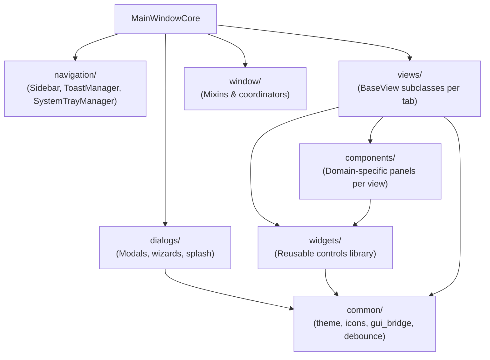

# Package Contract: `frontend`

## 1. Overview & System Scope

The `frontend` package is the entire presentation layer of MiniKick. It contains all PySide6/Qt views, reusable widgets, modal dialogs, navigation chrome, and window orchestration mixins. It has zero direct access to persistence or external APIs — all data flows inbound via Qt signals emitted by `backend/controllers/` and all user actions are propagated outbound through controller signal slots.

---

## 2. Component Topology



| Subpackage | Responsibility | Primary Exports |
| :--- | :--- | :--- |
| [`common/`](./common) | Design tokens, icon pipeline, `run_on_gui()`, debounce, QSS | `Palette`, `Size`, `get_icon_colored()`, `run_on_gui()`, `qt_debounce()`, `get_global_qss()` |
| [`views/`](./views) | Full-page tab views mounted into `QStackedWidget` | `BaseView`, `DashboardView`, `ChatView`, `CommandView`, `MusicView`, `AlertsView`, `SettingsView`, `LogView` |
| [`components/`](./components) | Domain-specific composite panels per view area | Alert cards, chat TTS panel, music queue, schedule form, widget cards |
| [`widgets/`](./widgets) | Reusable atomic UI controls | `ModernButton`, `ModernSwitch`, `TableWidget`, `SearchBar`, `ModernColorPicker`, `SegmentedControl` |
| [`dialogs/`](./dialogs) | Modal dialog shells and configuration wizards | `ModernModal`, `ModernWizardPanel`, `CommandConfigWizard`, `CrashReportDialog`, `SplashScreen` |
| [`navigation/`](./navigation) | Persistent chrome: sidebar, toast overlay, system tray | `Sidebar`, `ToastManager`, `SystemTrayManager` |
| [`window/`](./window) | `MainWindowCore` behaviour mixins and coordinators | `MainWindowStartup`, `MainWindowShutdown`, `NavigationCoordinator`, `SessionMetrics`, `MainWindowWiring` |

---

## 3. Public Interfaces & Contracts

### `MainWindowCore` ([`main_window.py`](./main_window.py))
Root `QMainWindow` composing all views, coordinators, and chrome.

```python
class MainWindowCore(QMainWindow):
    shutdown_finished: Signal  # emitted when teardown sequence completes

    def __init__(
        self,
        container: AppContainerCore,
        q_log_handler: Any,
        updater_manager: Any,
        app_version: str,
    ) -> None: ...
```
Navigation tabs defined via `_NAV_CONFIG` (11 tabs: Dashboard, Chat, Stream Info, Comandos, Timers, Music, Widgets, Triggers, Alerts, Settings, Developer).

### `BaseView` ([`views/base_view.py`](./views/base_view.py))
Base class for all tab view components.

```python
class BaseView(QWidget):
    view_shown: Signal   # emitted on first visible activation
```

### Dialog Shell (`dialogs/base_dialog.py`)
```python
class ModernFramelessShell(QDialog): ...      # Frameless base with drag/resize
class ModernModal(ModernFramelessShell): ...  # Confirmation-style modals
class ModernWizardPanel(ModernFramelessShell): ... # Multi-step wizard panels
class ModernConfirmDialog(ModernModal): ...
```

### `ToastManager` ([`navigation/toast_component.py`](./navigation/toast_component.py))
```python
class ToastManager(QObject):
    def show_toast(self, title: str, message: str, state: str, tag: str = "") -> None: ...
```
`state` values: `"success"`, `"error"`, `"warning"`, `"info"`.

### `run_on_gui` ([`common/gui_bridge.py`](./common/gui_bridge.py))
Thread-safe callable dispatch to the Qt main thread via `QMetaObject.invokeMethod`.
```python
def run_on_gui(fn: Callable, *args, **kwargs) -> None: ...
```

### Theme Design Tokens ([`common/theme.py`](./common/theme.py))
```python
class Palette: ...          # Raw hex color primitives
class Semantic: ...         # Semantic role tokens (bg, border, text)
class BrandColors: ...      # Platform brand colors (Kick, Twitch, YouTube)
class Size: ...             # Spacing and radius constants
class Typography: ...       # Font family and size scale
class Borders: ...
class Gradients: ...
```

---

## 4. Invariants

1. **Zero Backend Imports in `views/`, `widgets/`, `dialogs/`, `common/`**: These subpackages must never import from `backend/database/`, `backend/services/`, or `backend/providers/`. Data flows exclusively via controller-emitted Qt signals.
2. **`run_on_gui` for Cross-Thread UI Updates**: Any UI mutation triggered from a non-Qt thread must pass through `run_on_gui()` to avoid Qt thread-safety violations.
3. **i18n — Zero Hardcoded Strings**: All user-visible labels, placeholders, and error messages must be fetched via `i18n.get("key")`. Inline string literals in widget constructors are forbidden by rule.
4. **View Lazy Initialization**: `BaseView.view_shown` is emitted only on the first tab activation, enabling lazy controller wiring and deferring expensive data fetches.
5. **`QStackedWidget` Tab Routing**: `MainWindowCore` indexes views by `_NAV_CONFIG` position; `NavigationCoordinator.navigate_to(index)` is the only permitted navigation path.

---

## 5. Side Effects

| Category | Target | Description |
| :--- | :--- | :--- |
| **Qt Event Loop** | `QApplication` | All widget paint and signal dispatch runs on the main Qt thread. |
| **System Tray** | `SystemTrayManager` | Creates a system tray icon with context menu on Windows taskbar. |
| **Window State** | `%LOCALAPPDATA%/.Minikick/config.toml` | Persists window geometry and maximized state via `WindowStateManager`. |
| **Splash Screen** | `SplashScreen` | Renders a frameless progress window during startup; hidden before `MainWindowCore` is shown. |
| **Clipboard** | `QGuiApplication.clipboard()` | Copy-URL and Copy-Secret actions in settings views write to system clipboard. |

---

## 6. Verification

```bash
# Run automated UI and integration tests
pytest resources/tests/ -q

# Verify architectural boundaries (no backend imports in pure widgets)
python resources/tools/project_architecture_boundary_auditor.py --check
```
